# Red River QB

A first-person quarterback game played with Nintendo Joy-Cons. You line up under center at the Cotton Bowl for a night game of Texas vs Oklahoma, and you throw the ball by actually throwing with the Joy-Con. Built for HackTX 2026.

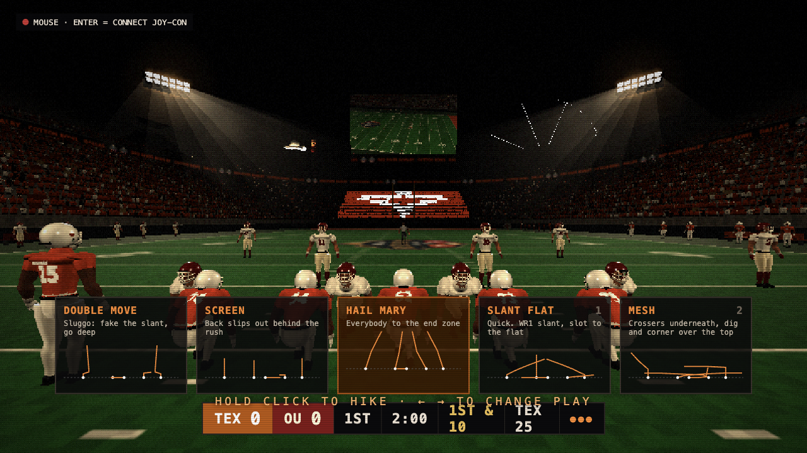

## Demo

| Smoke run-out | A pass play |
| --- | --- |
| [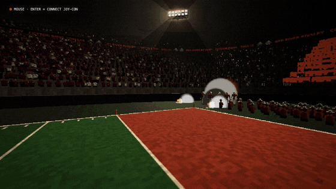](docs/media/runout.mp4) | [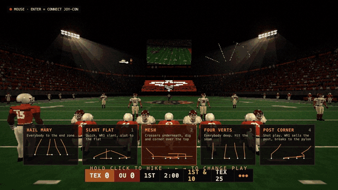](docs/media/play.mp4) |

Click a clip for the MP4. All media is captured from the game running on a Mac.

## Run it

Needs Node 20.19+ or 22.12+ and npm. Joy-Con input uses WebHID, so play it through Electron (or Chrome for `npm run web`).

```bash
git clone https://github.com/AlanRoybal/Hacktx26.git
cd Hacktx26
npm install
npm run dev        # Vite dev server + Electron, full screen
```

| Command | What it does |
| --- | --- |
| `npm run dev` | Dev server with hot reload, opened in Electron |
| `npm start` | Production build, then Electron |
| `npm run web` | Dev server only, open it in Chrome |
| `npm run typecheck` | TypeScript check |
| `RR_WINDOWED=1 npm run dev` | Windowed instead of full screen |

### Joy-Cons

1. Pair both Joy-Cons with the computer over Bluetooth (hold the small sync button on the rail until the lights run).
2. Start the game and press **Enter** to connect them. The tag in the top left turns green.
3. If one drops, press any button on it. Press **C** to recalibrate the stick.

Without Joy-Cons the game falls back to mouse and keyboard.

## Controls

| | Joy-Con | Mouse / keyboard |
| --- | --- | --- |
| Hike | Hold ZR (ZL on the left Joy-Con) | Hold click |
| Change play | Stick left / right | Left / right arrows or 1 to 4 |
| Move in the pocket | Stick | Arrows |
| Throw | Hold ZR, make a throwing motion, release at the top | Hold, aim, flick up, release |
| Scramble | Hold the stick forward, or click it | Hold up |
| Pause | Home (Capture on the left) | Esc |
| Spike / timeout | | S / T |
| Debug overlay | | D |

## Features

**Throwing from real motion.** The Joy-Con IMU is read over WebHID at full report rate. Arm speed sets ball speed, the angle at release sets the arc, how cleanly the Joy-Con rotates sets the spiral, and release timing is graded. Each throw shows its speed, launch angle, spiral grade and release grade.

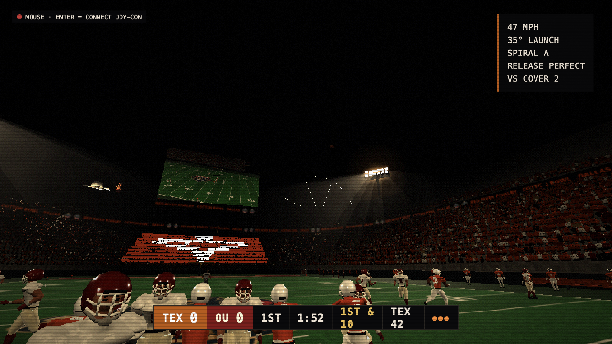

**A full game.** Solo is four 2:00 quarters from a 0-0 kickoff. You play every Texas drive, and Oklahoma's drives are simulated between yours. 1v1 swaps QBs and teams each drive, and each player picks their own Joy-Con. Three difficulties: Freshman, Starter and Heisman.

**Football that reacts.** About 14 plays with real routes, man and zone coverages and blitzes. Linemen swim, spin, rip and bull rush. You can scramble and throw on the run behind the line. Sacks, fumbles, interceptions, false starts, timeouts, spikes and the clock all work.

**Pressure.** Close scores, late downs and the red zone narrow and blur your vision, bring up a heartbeat, and pulse the Joy-Con rumble before the snap.

**Game day at the Cotton Bowl.** A pre-game intro with an aerial shot, the smoke tunnel run-out, Big Tex waving from the State Fair, and fireworks. A packed crowd, cheerleaders, the Freetail Hackers card mosaic, a jumbotron, real radio and TV calls, and several touchdown and sack celebrations.

| Aerial | Big Tex | Fireworks |
| --- | --- | --- |
| 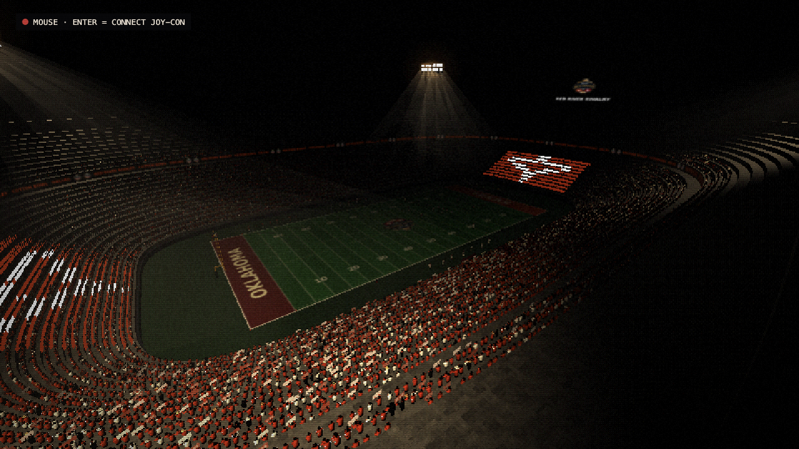 | [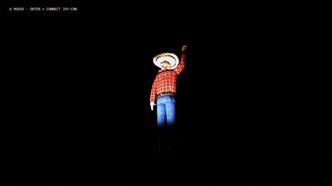](docs/media/bigtex.mp4) | 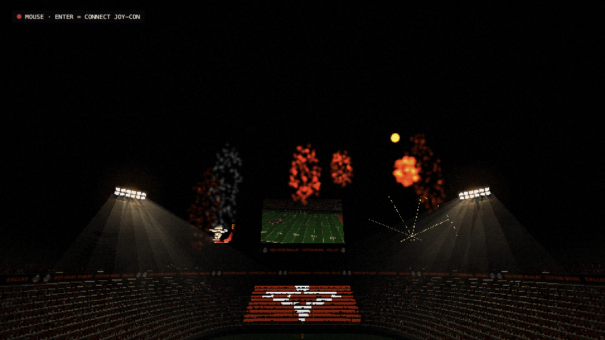 |

**Play of the game, on your phone.** After the final whistle, the best play is replayed, turned into a GIF and uploaded. A QR code on the game-over screen opens it on [hacktx26.alanroybal.com](https://hacktx26.alanroybal.com) with a download button.

| Game over | Clip page | The GIF |
| --- | --- | --- |
| 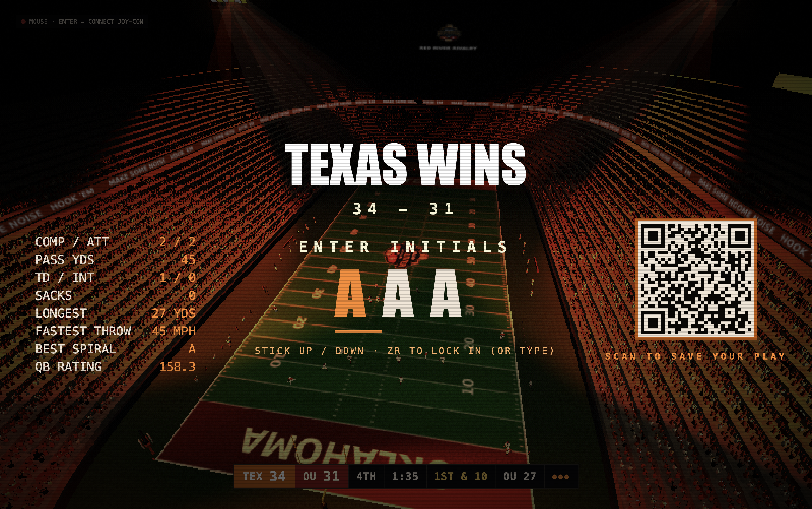 | 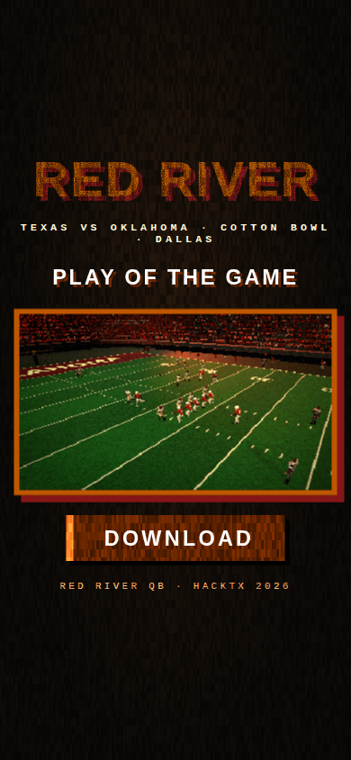 | 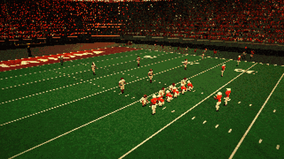 |

**Menus built for a loud hall.** Big distressed type, stick navigation, a pause screen with Joy-Con battery levels, and a leaderboard on the title screen.

| Title | Pause |
| --- | --- |
| 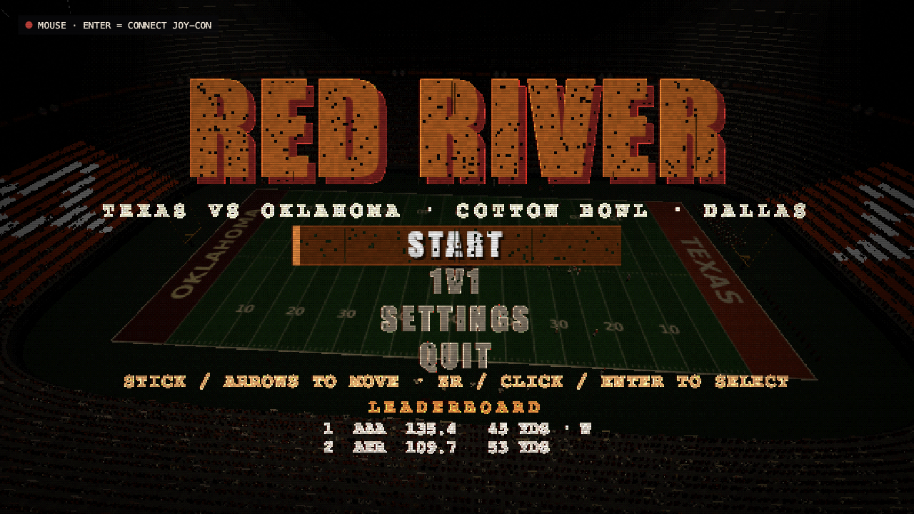 | 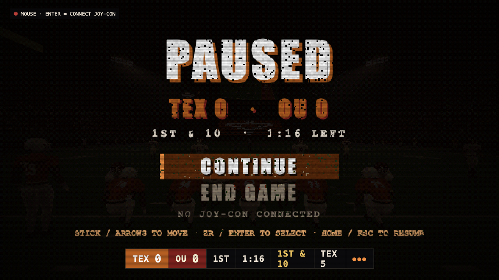 |

## Clip sharing setup

Uploads use the computer's AWS credentials (`aws configure`). `infra/hacktx26-infra.sh` creates the S3 bucket, the CloudFront distribution, the certificate and the DNS record, and uploads `site/index.html`. If the upload fails, the GIF is still saved on the computer and no QR is shown.

## Project layout

| Path | Contents |
| --- | --- |
| `src/input/joycon.ts` | WebHID Joy-Con driver: IMU, stick calibration, rumble, battery |
| `src/game/` | Game state, plays, physics, AI |
| `src/render/` | Three.js stadium, players, crowd, effects |
| `src/ui/` | HUD, menus, title and pause screens |
| `electron/` | Electron main process, dev launcher, clip upload |
| `site/` | Clip page for hacktx26.alanroybal.com |
| `tools/audio/` | Source list and script for the announcer clips |

The announcer audio is cut from real Texas and Oklahoma broadcasts for this demo. Sources are listed in `tools/audio/voice_lines.tsv`. Don't reuse it in anything published or sold.
